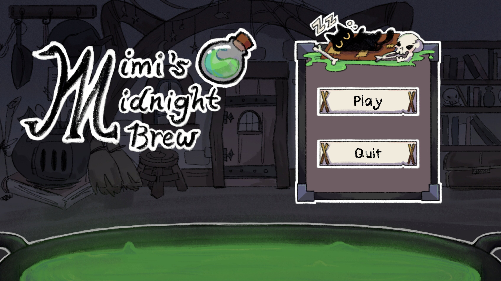
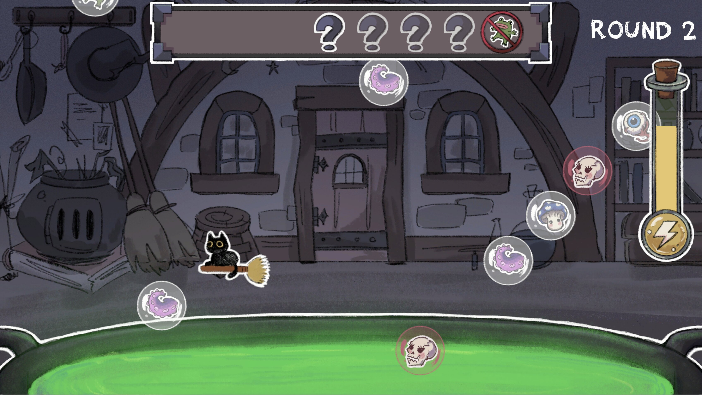
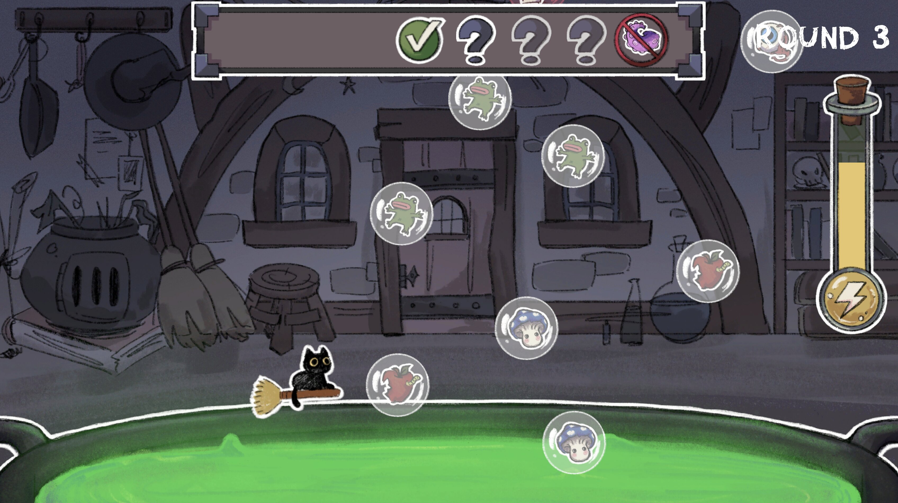

# Mimi's Midnight Brew
Help Mimi the witch cat brew potions in her giant cauldron! With limited time and a forgetful memory, Mimi needs your help to get the recipes just right. Memorize the ingredients and pop the right bubbles before time runs out, or risk ruining her potions!

Created for the Cornell University DGA Fall 2026 Game Jam. Won Judge's Pick.

## Play the Game
The best way to experience Mimi's Midnight Brew is to play it yourself.

[Download on itch.io.](https://boosterball478.itch.io/mimis-midnight-brew)

## How to Play

Pop bubbles to drop ingredients into Mimi’s cauldron! Follow the recipe from left to right, but watch out for wrong ingredients; they’ll cost you time! The banned ingredient has an even bigger penalty. The candy corn in the green bubble can replace any ingredient, while the skull in the red bubble is always wrong. Each correct ingredient gives you back a little time! Every round gets harder. See how far you can make it; happy brewing with Mimi!

### Controls

| Key | Action |
| ----------- | ----------- |
| WASD | Move |
| Space | Pop bubble |
| E | Peek at recipe (costs time) |

## Features

- Memory-based potion brewing: follow each recipe from left to right.
- Bubble-popping gameplay that drops ingredients into Mimi’s cauldron.
- A race against the clock, with time rewards for correct ingredients and penalties for mistakes.
- Special ingredients: wildcard candy corn, a dangerous skull, and a banned ingredient to avoid.
- Increasingly challenging rounds to test your memory and timing.

## Screenshots
#### Gameplay

## Requirements
- Unity 6.0 LTS

## Installation (Unity Editor)
### 1. Clone the repository
    git clone https://github.com/CadenLau/Fall26-Jam.git
### 2. Open in Unity
1. Open Unity Hub.
2. Click Add -> Add project from disk.
3. Select the cloned project folder.
4. Open the project using Unity 6.0 LTS.

## Running the Game in Unity
Open MainMenuScene from the Assets/Scenes folder and press play.

## Project Structure
    ├── Assets/
    |   ├── Art/
    |   ├── Prefabs/
    |   ├── Scenes/
    |   ├── Scripts/
    |   ├── Settings/
    |   ├── Sound/
    |   └── TextMesh Pro/
    ├── gameplay/
    ├── Packages/
    ├── ProjectSettings/
    ├── LICENSE.txt
    ├── .gitignore
    └── README.md

## Built With
- Unity 6.0 LTS

## Creators
- Caden Lau (Programmer)
- Sophia Li (Artist)
- Joanne Chen (Artist)

## License
This project is licensed under the Creative Commons Attribution–NonCommercial–ShareAlike 4.0 International License (CC BY-NC-SA 4.0).

You are free to play, share, and modify this project for non-commercial purposes, with appropriate attribution.

See [`LICENSE`](LICENSE.txt) file for details.
